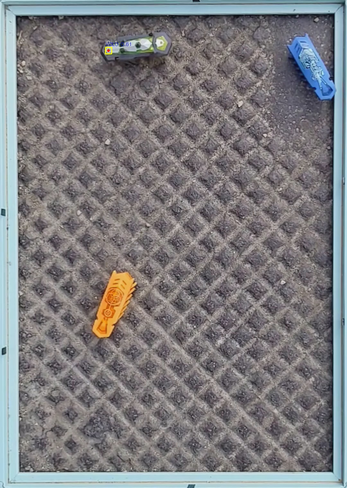

# Hexbug Detection & Tracking

Detect and track [Hexbug](https://www.hexbug.com/) toy robots in top-down video.
A single-class YOLOv8 detector is trained on head-point annotations, then
detections are linked across frames with SORT.

Built for the FAU *Tracking Olympiad* seminar.

<p align="center"></p>

## Pipeline

```
raw videos + CSV point annotations
        │
        ├─ scripts/Generate_bboxes.py        → clean frames  (YOLO_train/images/train)
        ├─ YOLO_train/generate_yolo_labels.py → YOLO labels   (YOLO_train/labels/train)
        ├─ YOLO_train/split_dataset.py        → train / val split, by video
        ├─ YOLO_train/dataset_augmentation.py → optional offline augmentation
        └─ YOLO_train/train_yolo.py           → runs/train/<name>/weights/best.pt
                                                      │
test video ───────────────────────────────────────────┤
        ├─ YOLO_train/test_model.py    detection only          → annotated .mp4
        ├─ YOLO_train/track_sort.py    detection + SORT        → tracked .mp4   (supported)
        └─ YOLO_train/condensation.py  detection + particle filter (experimental)
```

Each Hexbug is annotated as a single head point `(x, y)` per frame. Labels are a
fixed 20×20 px box centred on that point, class `0 = hexbug`.

## Setup

```bash
git clone <this repo>
cd Hexbug_Final
python -m venv .venv && .venv\Scripts\activate      # Linux/macOS: source .venv/bin/activate
# Install a CUDA build of torch first if you have a GPU: https://pytorch.org/get-started/locally/
pip install -r requirements.txt
```

Python 3.10 was used. Scripts auto-select GPU when available and fall back to CPU.

### Data and weights (not in git)

| What | Where it goes | Source |
|---|---|---|
| 100 training videos (`training001.mp4` …) | `dataset/raw_videos/` | seminar dataset |
| 5 test videos | `dataset/test_videos/` | seminar dataset |
| Point annotations (`.csv`, `.traco`) | `dataset/csv_files/`, `dataset/txt_files/` | **included in repo** |
| Trained detector `best.pt` (43 MB) | `YOLO_train/runs/train/hexbug_train10/weights/` | GitHub Release |
| SAM ViT-B checkpoint (optional) | `checkpoints/sam_vit_b_01ec64.pth` | [facebookresearch/segment-anything](https://github.com/facebookresearch/segment-anything#model-checkpoints) |

CSV columns: `t` (frame), `hexbug` (id), `x`, `y`.

## Usage

Build the dataset (writes ~16 GB of PNG frames):

```bash
python scripts/Generate_bboxes.py              # add --draw for QA images with boxes
python YOLO_train/generate_yolo_labels.py
python YOLO_train/split_dataset.py             # 20% of *videos* → val, seed 42
python YOLO_train/dataset_augmentation.py      # optional
```

Train (from `YOLO_train/`, so `data.yaml` resolves):

```bash
cd YOLO_train
python train_yolo.py --epochs 80               # starts from COCO yolov8s.pt
```

Inference / tracking:

```bash
python YOLO_train/test_model.py --video dataset/test_videos/test005.mp4
python YOLO_train/track_sort.py  --video dataset/test_videos/test001.mp4
python YOLO_train/condensation.py --video dataset/test_videos/test001.mp4
```

Outputs land in `YOLO_train/ran_tests/`. All scripts accept `--help`.

## Results

Final run `hexbug_train10` (YOLOv8s, 640 px, batch 16, cosine LR 0.005, early-stopped
at epoch 31). Full curves in [docs/hexbug_train10/results.csv](docs/hexbug_train10/results.csv).

| Metric (val, best epoch 28) | |
|---|---|
| Precision | 0.999 |
| Recall | 0.985 |
| mAP@50 | 0.995 |
| mAP@50-95 | 0.909 |

**Caveat:** this run used an earlier per-frame train/val split, so neighbouring
frames of the same video sat on both sides and these numbers overstate
generalisation to unseen videos. The current `split_dataset.py` splits by video;
re-train to get honest numbers. The same run also used labels that dropped
extra Hexbugs on multi-Hexbug frames (fixed in `generate_yolo_labels.py`).

## Trackers

- **SORT** (`track_sort.py`) — Kalman filter + IoU + Hungarian assignment. Supported path.
  Vendored from [abewley/sort](https://github.com/abewley/sort) (GPL-3.0), see `YOLO_train/sort/`.
- **Condensation / particle filter** (`condensation.py`) — own implementation, 100 particles
  per track, IoU-weighted resampling. Experimental.
- **ByteTrack** — attempted; integration was never completed and is not in the repo.

`scripts/mask_hexbugs_SAM.py` is a side experiment that prompts Segment Anything
with the head points to recover full-object boxes; it produces visualisations only.

## Layout

```
dataset/        csv_files/ txt_files/ (tracked)  raw_videos/ test_videos/ (ignored)
scripts/        frame extraction, annotation QA, SAM experiment
YOLO_train/     labels, split, augment, train, inference, trackers, data.yaml, sort/
docs/           metrics of the final training run
```

## License

MIT for this project's code. `YOLO_train/sort/sort.py` is GPL-3.0 (Alex Bewley).
